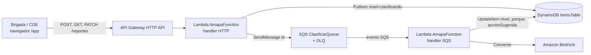

# Diseño — Reporte de puntos críticos priorizado con IA

## Punto de partida (lo que ya está desplegado)
El stack `amapa-iathon` (us-east-1) ya tiene una HTTP API, una sola Lambda, `ItemsTable` (DynamoDB), CloudWatch Logs y el permiso `bedrock:InvokeModel` sobre `MODEL_ID` (Claude Haiku 4.5, perfil `us.`). Ver `.kiro/specs/amapa-serverless/`.

**Diferencia con el enunciado:** el runtime real es **Node.js 22** (`backend/src/`), no Python 3.12 con `src/app.py`, y el frontend está en `frontend/src/`, no en `src/web/`. El diseño mantiene ese stack: reescribirlo en Python no aporta nada a la historia de usuario y pone en riesgo las insignias que ya están verificadas.

## Arquitectura mínima

| Cambio en `template.yaml` | Detalle |
|---|---|
| `ClasificarQueue` + `ClasificarDLQ` (SQS) | Timeout de visibilidad de 30 s y `maxReceiveCount` 3. Es el único servicio nuevo y queda declarado en el template. |
| Evento `SQS` en `AmapaFunction` | `BatchSize: 1`. La misma función distingue el evento HTTP del evento SQS. |
| Permisos | `sqs:SendMessage` sobre la cola (los permisos de lectura los añade SAM al declarar el evento). Se mantiene DynamoDB `PutItem`/`GetItem`/`Scan`/`UpdateItem` y `bedrock:InvokeModel` solo sobre `MODEL_ID`. |
| Rutas | `POST /reportes`, `GET /reportes`, `PATCH /reportes/{id}` |
| Variable | `QUEUE_URL` |

**Plan B sin SQS:** si la cola se complica, se clasifica al leer, como ya hace `/jobs`. `GET /reportes` clasificaría los reportes pendientes en segundo plano. El contrato no cambia.

## Datos en DynamoDB
- `id = "reporte#<uuid>"`, `kind = "reporte"`, y los campos del contrato en camelCase (`tipoPeligro`, `personasEnRiesgo`, …), más `nivel`, `porque`, `accionSugerida`, `estado`, `fecha` y `fuente` (`bedrock` | `reglas`).
- `GET /items` ya excluye los registros con `kind`, así que las insignias no se ven afectadas.
- `GET /reportes` usa `Scan` paginado con el filtro `kind = reporte` (en la demo hay menos de 100 reportes) y ordena en memoria.

## Clasificación con IA (`backend/src/services/clasificador.js`)
- **Prompt de sistema:** analista del COE Piura con los criterios EDAN rojo, amarillo y verde de `requirements.md`. Los datos del reporte van dentro de `<reporte>` y se tratan como datos, no como instrucciones.
- **Formato de salida:** solo JSON `{"nivel","porque","accionSugerida"}`, con `porque` de 15 palabras como máximo, `accionSugerida` de 120 caracteres como máximo y `maxTokens` 200.
- **Validación de la salida:** `nivel` debe estar en la lista permitida y los textos se recortan. Si la salida no es válida, se usan las reglas por código.
- **Errores:**
  - Ante `ThrottlingException`, reintento con backoff exponencial (como `briefingService.js`).
  - Ante timeouts y errores 5xx del modelo, se aplican las reglas por código.
  - Ante otros errores, se registran en el log y también se aplican las reglas. En segundo plano no hay usuario a quien devolver un 502.
- **`reglasEdan(reporte)`:** función pura y determinista con los mismos criterios. Se usa como respaldo y como referencia en los tests.

## Cambios en el backend (`backend/src/`; en el enunciado, `src/app.py`)
- `routes/reportes.js`: validación, 201, 400, 404 y orden de la lista. Se registra en `createApp({ …, reportesStore, queue, clasificador })`.
- `lambda.js`: despacha por tipo de evento (HTTP → `serverless-http`; `Records[].eventSource == aws:sqs` → clasificar).
- `db/seedReportes.js`: los 8 reportes de demo con datos simulados.

## Cambios en el frontend (`frontend/src/`; en el enunciado, `src/web/`)
- `MapView.jsx`: círculos por nivel (gris si está clasificando) con radio proporcional a `personasEnRiesgo`. Los asegurados se dibujan con borde punteado y color atenuado.
- `ReportesTable.jsx` (nuevo): tabla ordenada con los botones "En atención" y "Asegurado", y un contador de rojos pendientes y asegurados.
- `NuevoReporteModal.jsx` (nuevo): formulario EDAN con clic en el mapa para fijar lat/lng y el botón "Usar foto de ejemplo".
- `api.js`: añade `getReportes`, `createReporte` y `patchReporte`. `App.jsx` consulta cada 5 s.
- **Mapa:** Leaflet + OpenStreetMap, que ya está en el proyecto y es el plan B del documento. Google Maps y Amplify quedan fuera porque requieren servicios externos que no están en `template.yaml`. El frontend se sigue sirviendo en `/app`.

## Pruebas
- `node:test` con un almacén falso, una cola falsa y un cliente Bedrock simulado. Cubren 201/400/404, el orden, el cambio de estado, la salida JSON del modelo (válida, inválida y con throttling) y `reglasEdan` en cada criterio.
- Humo en AWS: hacer POST con un reporte simulado y consultar `GET /reportes` cada 1,5 s hasta ver su color (menos de 12 s).
